# 现场录屏

现场 7 段盲测均有一镜到底录屏（手机拍摄），**01–07 全部入库**，共 131 MB（`盲测01–07.mp4`）。
逐段结论见 `../盲测结果.csv`，音频见 `../现场录音/盲测0X.wav`。

## 一、每段都对上了三条独立线索

单靠文件名归档只是"我说它是第几段"，所以每段都用三个互不依赖的证据交叉核过：

1. **画面里的手写纸条**——换工况前在纸上写了工况名，正对镜头（`01_原始声振数据/` 的照片里也有同款纸条）。03「二档全遮挡」、04/05「二档半遮」、06/07「一档全遮」字迹可辨；02 无纸条、扇面敞开，与"无遮挡"相符；01 画面内没有纸条。
2. **画面里的对话界面**——附件名带时间戳，任务行写明第几段：
   `16点39分.wav` +「诊断第二段盲测录音」、`16点50分.wav` +「对比盲测03与四类特征中位」、
   `16点55分.wav` +「下载并诊断第四段盲测录音」、`16点59分.wav` +「下载并诊断第五段」、
   `17点07分.wav` +「下载并诊断第六条录音」、`17点31分.wav` +「对盲测07跑模型预测」。
3. **视频自带音轨的主音**——与 `盲测0X.wav` 的实测主音比，方法：0.5 s 一帧取前 5 个谱峰，判 ±5% 命中，找最长连续命中段。

| 编号 | 录屏文件 | 时长 / 规格 | 画面里的附件名与任务行 | 画面里的纸条 | 音轨主音 vs wav |
|---|---|---|---|---|---|
| 01 | `盲测01.mp4` | 133.7 s · 960×544 H.264 | 16点34分.wav（90–133 s 屏幕段） | 画面内无纸条 | 72–96 s **≈722 Hz**；wav 708 → +2.0%，同属半遮挡簇 |
| 02 | `盲测02.mp4` | 183.6 s · 1280×720 HEVC | 16点39分.wav ·「诊断第二段盲测录音」 | 无纸条、扇面敞开 | **全程未检出 745 Hz**（0/367 帧），详见第三节 |
| 03 | `盲测03.mp4` | 172.6 s · 960×544 H.264 | 16点50分.wav ·「对比盲测03与四类特征中位」 | 「二档全遮挡」 | **1392 Hz**；wav 1345 → +3.5%，与 L4 高速态 1386 差 0.4% |
| 04 | `盲测04.mp4` | 125.5 s · 1280×720 HEVC | 16点55分.wav ·「下载并诊断第四段盲测录音」 | 「二档半遮」 | **712 Hz**，连续 23.0 s；wav 711 → +0.1% |
| 05 | `盲测05.mp4` | 175.8 s · 1280×720 HEVC | 16点59分.wav ·「下载并诊断第五段」 | 「二档半遮」 | **730 Hz**，连续 15.0 s；wav 729 → +0.1% |
| 06 | `盲测06.mp4` | 125.5 s · 960×544 H.264 | 17点07分.wav ·「下载并诊断第六条录音」 | 「一档全遮」 | **1088 Hz**，连续 42.0 s；wav 1088 → 0.0% |
| 07 | `盲测07.mp4` | 435.1 s · 960×544 H.264 | 17点31分.wav ·「对盲测07跑模型预测」 | 「一档全遮」（1 s 处可辨） | **1074 Hz**，连续 49.5 s；wav 1074 → 0.0% |

规格说明：02/04/05 为 1280×720、HEVC、立体声，03/06/07 与 01 为 960×544、H.264、单声道，音轨均 44.1 kHz。
分辨率与编码不同是微信传输压缩（原片在手机里）的结果，不是剪辑。

时间线对得上：`盲测01–07.wav` 的文件时间依次为 16:35 / 16:39 / 16:51 / 16:56 / 17:00 / 17:08 / 17:32，
与画面里附件名的时间戳各差约 1 分钟（录完保存的时点），7 段落在 16:34–17:31 这一小时内。

## 二、关键帧：不下载视频也能看清

每段取两帧存 `关键帧/`（左＝桌面布场与纸条，右＝屏幕上收到的该段文件与任务行），共 272 KB。
缩略图为 400 px，点开是 900 px 原尺寸，能读出时间戳与纸条上的字。**01 的两帧已转正**（原片 180° 倒置）。

| 段 | 桌面：纸条 / 布场 | 屏幕：收到的文件 + 任务行 |
|---|---|---|
| 01 | 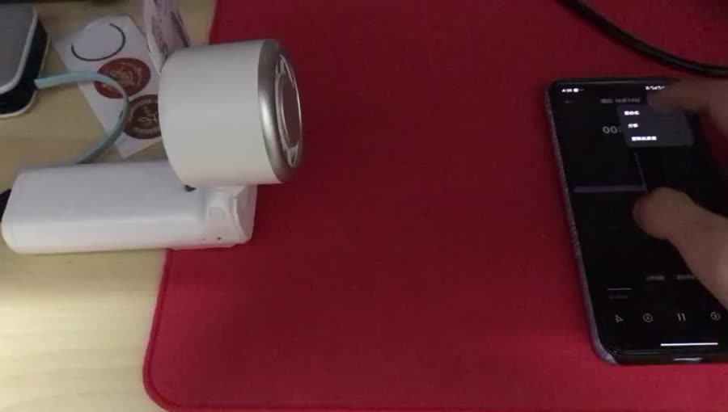 | 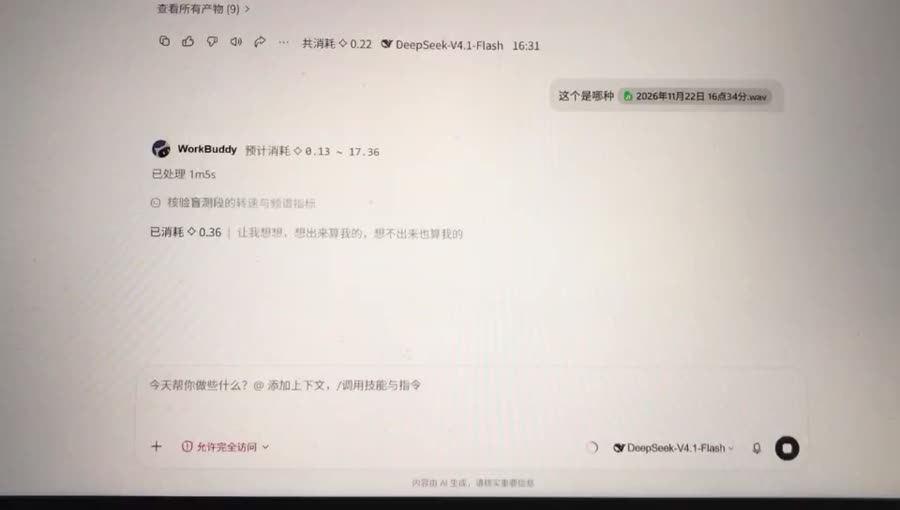 |
| 02 | 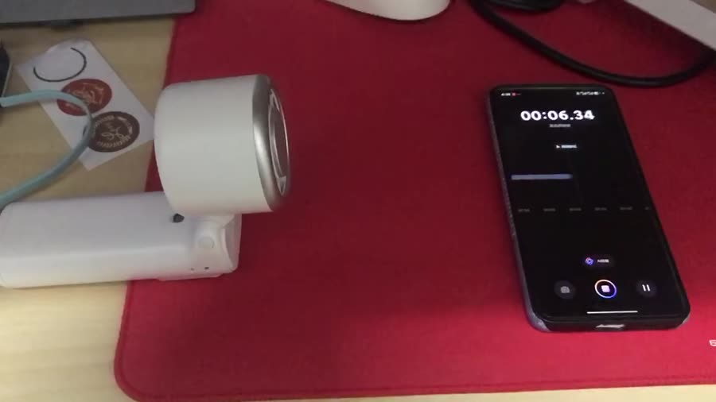 | 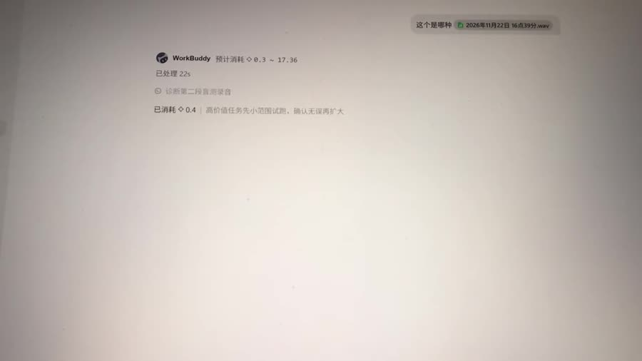 |
| 03 | 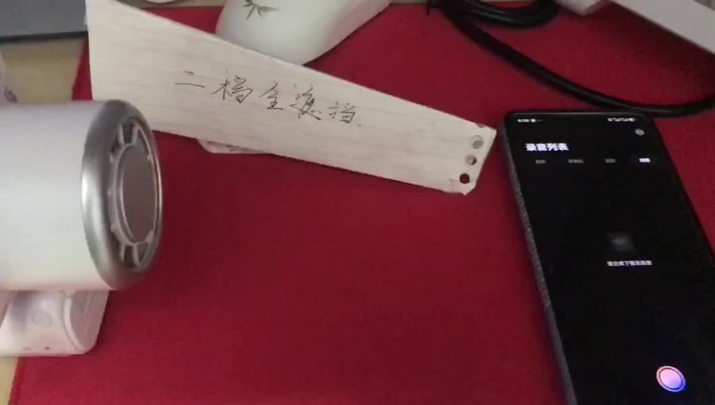 | 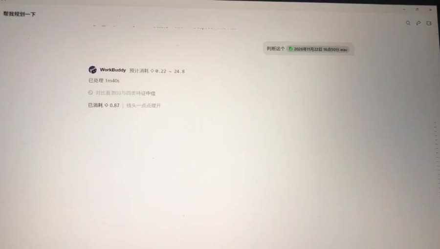 |
| 04 | 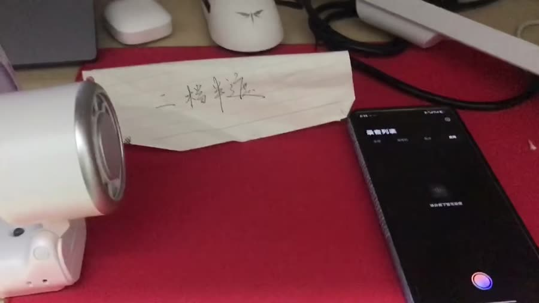 | 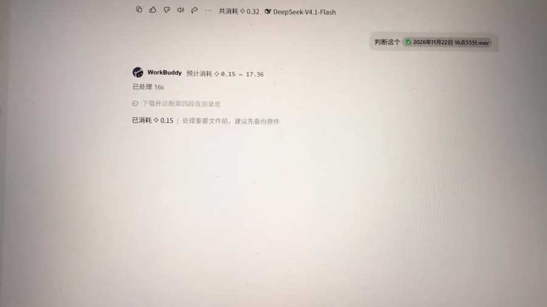 |
| 05 | 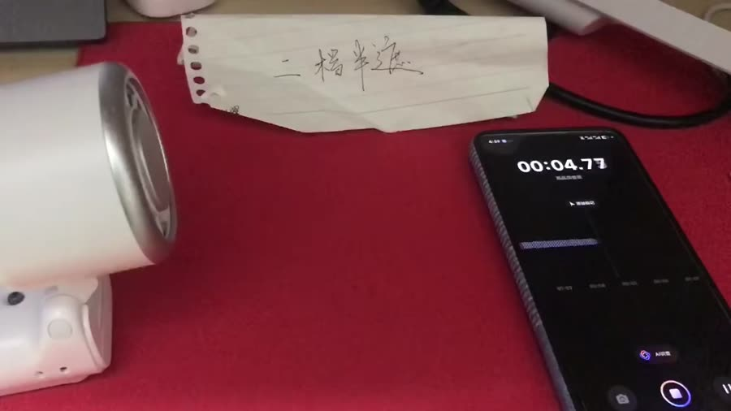 | 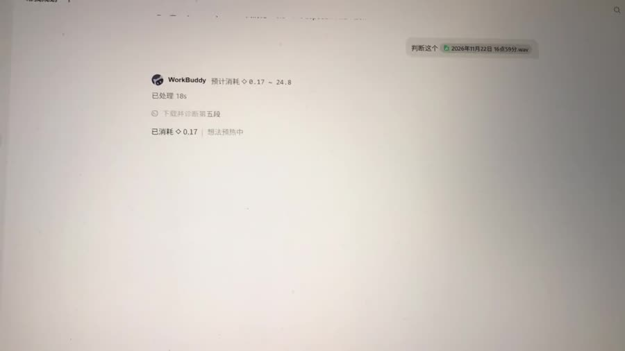 |
| 06 | 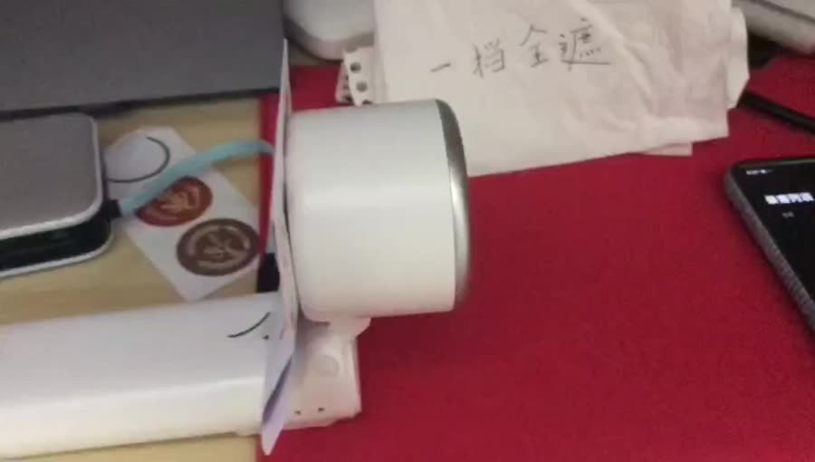 | 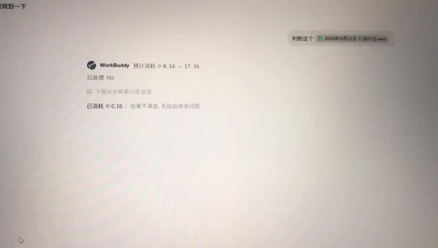 |
| 07 | 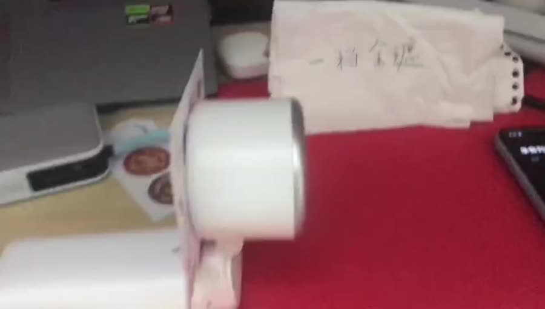 | 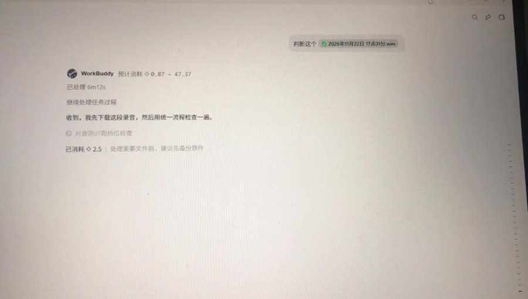 |

## 三、盲测02 的音轨不自证（如实记录）

02 是全 7 段里唯一"音轨对不上 wav"的：全程 3 分 04 秒，**745 Hz 一次都没进过前 5 峰**（0/367 帧）。
作为对照，04/05/06/07 在各自频段能连续命中 23.0 / 15.0 / 42.0 / 49.5 s，01、03 也能命中（2.0% / 3.5% 偏差）。
02 有的是另一组东西：

- 0–46 s 一段稳定谐波族，基频 **110.0 → 112.2 Hz**（缓慢上扬 2%），最强落在 21 阶与 24 阶
  （2314→2357、2645→2691 Hz），也看得到 2/3/4 阶（224、336、447 Hz）；
- 46 s 处骤然消失（1 s 内掉 8 dB），随后是键盘声与说话声，画面转向笔记本。

两种读法都说得通，本文件不替它下结论：一是当时风扇跑在更快的状态（基频 110.9 Hz 正是建档三档自由态，
`档位验证_20261122.wav` 第三段读数），与标注的"二档无遮挡"不符；二是这组音来自旁边的笔记本散热风扇，
而手持风扇本身没转或太远。无论哪种，这段录屏**不能佐证** `盲测02.wav` 的 745 Hz。

`盲测结果.csv` 里 02 本来就记作"不计"，这一条不改变任何指标；它的价值是提示：
**02 的现场记录本身不可靠**（wav 读数与录屏音轨相互矛盾），后续再有类似情况应当场重录，而不是事后解释。

## 四、三条边界

1. **画面里没有 `predict.py` 的终端窗口。** 7 段都是"桌面设工况 → 手机录音 → 在对话里下发判断 → 看任务进度"，
   判决在对话界面呈现（如 07 段「对盲测07跑模型预测」处理 6 分 12 秒）。也就是说，
   录屏证明"这段音是当场现场录的"，不完全等同于"当场在终端跑脚本出结论"。报告 1.1 节与 13 节按这个口径写明。
2. **扇面遮挡状态多数看不清。** 手机背对镜头、近距离过曝，纸片贴法看不清；判读遮挡程度请看
   `01_原始声振数据/` 下三张布场照片，录屏只作时间与工况的旁证。
3. **07 段长 7 分 15 秒**，是因为当次分析耗时 6 分 12 秒（画面可见"已处理 6m12s"），不是重复录制。

## 五、复核命令

```bash
# 音频判决（在 04_分析脚本/ 下）
python predict.py "../05_盲测与抗噪/现场录音/盲测07.wav"

# 只核音轨主音（零依赖，直接读 wav）
python gear_check.py "../05_盲测与抗噪/现场录音/盲测07.wav"
```

视频音轨的核对用 ffmpeg 抽音频后做 FFT 即可，本次结果见上表；所用 ffmpeg 路径与抽帧命令不写进交付物，
避免依赖外部工具链（本项目的分析脚本一律零第三方依赖）。
